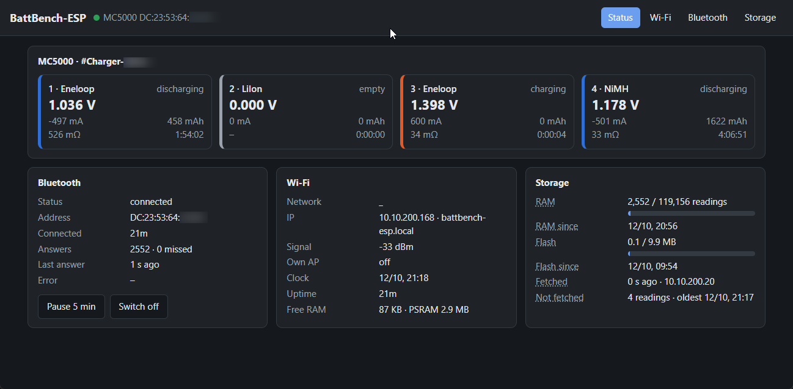

# BattBench-ESP

**Makes your SkyRC MC5000 Wi-Fi ready and adds a data buffer.**

Firmware for an **ESP32-S3-DevKitC-1 (WROOM-1-N16R8: 16 MB flash, 8 MB octal PSRAM)** that bridges a
**SkyRC MC5000** (or MC3000) charger to [BattBench](https://github.com/fashberg/battbench): it keeps the Bluetooth LE
connection to the charger, polls all slots, stores every answer and serves them over Wi-Fi. BattBench fetches them
from there – also everything recorded while the PC was off – and sends the charger commands of its MC5000 charge
profiles through it.

```
         mains power (MC3000: DC)
                   │
                   ▼
        ┌──────────────────────┐
        │    SkyRC MC5000      │
        │   (or MC3000)        │
        └──────────────────────┘
           ▲               │
           │ Bluetooth LE  │ USB-C power output
           │ (status,      │ (power only, no data)
           │  commands)    ▼
        ┌──────────────────────┐
        │   ESP32-S3           │
        │   BattBench-ESP      │
        │   data buffer        │
        └──────────────────────┘
                   ▲
                   │ Wi-Fi (HTTP, mDNS)
                   ▼
        ┌──────────────────────┐
        │   BattBench          │
        │   (Windows / Mac)    │
        │   charts, analysis   │
        └──────────────────────┘
```



## What it sends to the charger

- By itself only the handshake `57` (MC5000; without it the charger answers every query with its greeting
  `0F 04 06 01 01 08`) and the status queries: MC5000 `0F 03 91 <bit> cs`, MC3000 `0F 55 <slot> …`. Never the init
  sequence `74` / `65` / `FE` of the SkyRC app, which restarts or stops running tasks.
- On request of BattBench (`POST /api/command`, see below), for one slot at a time: MC5000 `94` program (starts by
  itself when a battery is in), `FE` stop, `98` voltage curve of the current phase, and the read-only `5F` (slot
  summary with currents) and `96` / `95` (system settings: sounds, backlight, screen timeout). BattBench sends them
  only after the user confirmed a start or stop.

The handshake does not interrupt running tasks.

## Install

Ready-built firmware is on the [releases](https://github.com/fashberg/battbench-esp/releases) page:
- **First install** over USB: flash `battbench-esp-<version>-factory.bin` at address `0x0`.
  - In the browser (Chrome or Edge): open Espressif's web flasher
    [espressif.github.io/esptool-js](https://espressif.github.io/esptool-js/), plug the ESP32 into the USB port
    marked "COM" (UART), *Connect*, choose the port, flash address `0x0`, choose the file, *Program*.
  - Or on the command line: `esptool.py --chip esp32s3 write_flash 0x0 battbench-esp-<version>-factory.bin`.
- **Update**: upload `battbench-esp-<version>-update.bin` on the web page (*Settings → Firmware update*); the stored
  readings and settings stay.

## Build and flash

PlatformIO (pioarduino platform `espressif32` 55.03.x, ESP-IDF 5.5). On Windows run it **from PowerShell or cmd, not
from Git Bash** – ESP-IDF stops under MSYS ("MSys/Mingw is not supported"):

```powershell
cd battbench-esp
& "$env:USERPROFILE\.platformio\penv\Scripts\pio.exe" run                      # build
& "$env:USERPROFILE\.platformio\penv\Scripts\pio.exe" run -t upload            # flash (USB port "COM")
& "$env:USERPROFILE\.platformio\penv\Scripts\pio.exe" device monitor           # log, 115200 baud
```

Later updates also work over the web page (*Settings → Firmware update*, file `.pio\build\esp32s3-n16r8\firmware.bin`;
two OTA partitions) or `POST /api/ota`.

The pio core has to match the platform (platform 55.03.39: `pioarduino==6.1.19`).

## First start

1. Without Wi-Fi settings the ESP opens the access point **BattBench-XXXX** (password `battbench`), page
   http://192.168.4.1.
2. Tab *Wi-Fi*: scan, choose the network, enter its password → *Save and restart*. Then it is reachable as
   http://battbench-esp.local (mDNS, host name adjustable). If the network is gone for 30 s, the access point comes
   back.
3. Tab *Bluetooth*: leave empty = the first SkyRC charger found (best signal), or pick its address from the list.
   Close the SkyRC app on the phone first (the charger takes only one Bluetooth connection).
4. BattBench finds the ESP by itself (mDNS, service `_battbench._tcp`, TXT `id` = MAC; *Find BattBench-ESP in the
   network automatically* in its "+" dialog, on by default). By hand: "+" dialog → *BattBench-ESP* → host name or IP
   → *Apply*.

## Status LED (WS2812, GPIO48; board v1.1: GPIO38, adjustable under *Settings*)

| LED | Meaning |
|---|---|
| blue | Bluetooth connected; briefly dark = a reading came in |
| blue / green | all occupied slots done |
| blue / red | flash log ≥ 95 % full and BattBench has not fetched the oldest readings yet |
| red | error: charger not found / not answering, or a slot reports an error |
| orange | Wi-Fi error (not connected, only the own access point; from 20 s after the start) |
| blue / orange, green / orange, red / orange | as above, plus a Wi-Fi error |
| blue, slowly pulsing | looking for the charger, Wi-Fi fine |
| violet | Bluetooth paused or switched off |

**Pause / switch off Bluetooth** (status page and tab *Bluetooth*, API `POST /api/ble` with `{"pause": 5}` or
`{"on": false}`): the charger takes only one Bluetooth connection. While the ESP is connected, neither the SkyRC app
nor BattBench's own Bluetooth can reach it. *Pause 5 min* disconnects at once and connects again by itself afterwards;
*Switch off* also holds across a restart. BattBench offers the same in its charger settings and shows a pause on the
slot tiles.

## Storage: how far without an SD card?

| Level | Content | Size | Lasts (4 occupied slots) |
|---|---|---|---|
| RAM ring (PSRAM) | every answer, compressed | 5 MB ≈ 500,000 readings | ≈ 3 days at a query every 2 s |
| Flash log | thinned + compressed | 9.9 MB (2528 sectors of 4 KB) | ≈ 5 months (60 s, default); ≈ 4 weeks at 10 s; ≈ 6 days unthinned |

- **Thinning** as `db.SampleThinner` in BattBench: at most one reading per slot every `thin_secs` (default 60 s,
  adjustable, 0 = all); a change of status, mode, error, battery type, current direction or empty / occupied is
  written at once, together with the reading before it and the last one under load. Empty slots only once. While
  BattBench fetches all the time it gets every reading from RAM (and stores one every 10 s itself); the flash log
  only bridges times without fetching, one point per minute is enough there.
- **Compression** (flash and RAM, in blocks of 4 KB): per block and slot one full packet, after that only the
  changed bytes (bit mask + bytes), sequence and time step as varints. Measured with 5.2 days of real charger data: **≈ 10 bytes per reading** instead
  of 23 + time (host test, see below).
- Estimate: 4 slots, 60 s → 0.067 readings/s × 11 B ≈ 65 KB/day (plus status changes) → 9.9 MB ≈ 5 months; at 10 s:
  0.4 readings/s × 10 B ≈ 350 KB/day → ≈ 28 days. A charger that does nothing (empty slots) writes almost nothing.
- When the log is full, the oldest sector is overwritten. Wear: only erasing a sector wears the flash, and that is
  spread over all 2528 sectors. Even unthinned each sector is erased only about every 6 days (≈ 1600 years at 100,000
  cycles).
- An **SD card** would only help for months without a PC. Planned as a further target behind the flash log (not
  built in).

BattBench asks with `since=<last number>`: new readings come complete from RAM (every 2 s), older ones from the flash
log (thinned).

**When is it written, what can get lost?**
- The flash log is written **continuously**, not in blocks and not only when RAM is full: every reading the thinning
  keeps is in flash at once (body first, tag byte last, so it survives a power cut).
- The thinning holds back the newest reading of each slot until it is clear whether it is needed (the reading before
  a status change). On every `esp_restart()` (settings, update, *Restart* button) a shutdown handler (`store_flush`)
  writes these readings first.
- **Power cut**: the RAM ring is gone; the flash log lacks at most the last `thin_secs` per slot that BattBench had
  not fetched yet. Saving RAM to flash on a power cut is not possible (no reserve after unplugging); while BattBench
  fetches continuously it misses nothing anyway.
- **Fetching deletes nothing.** RAM and flash are rings that drop the oldest readings when full. The ESP remembers the
  last fetched number, time and IP (NVS every 10 min and before a restart). The web page shows them as *Fetched* and
  *Not fetched* (count and oldest unfetched reading; while part of them is only in flash, the count is estimated from
  the sectors, ±5 %). The LED reports "storage full" when the flash is ≥ 95 % full and the oldest reading has not been
  fetched.

## Time

Every reading carries the boot counter and the uptime (0.1 s). As soon as the clock is known (SNTP `pool.ntp.org`,
otherwise BattBench sets it with `POST /api/time`), the offset of this boot is stored in NVS. So readings taken before
the clock was set get their real time as well. Readings of a boot that never had a clock cannot be placed in time;
BattBench skips them.

## API

| | |
|---|---|
| `GET /api/info` | firmware, `logid`, `now` (0 = clock not set), `src` (current charger), `chargers` [{src, model, addr}] |
| `GET /api/status` | Wi-Fi (`ps` = power save), Bluetooth (`state`, `on`, `paused_secs`, `itvl_ms` …), storage, live values of the slots (for the web page) |
| `GET /api/records?since=N&max=M` | `{logid, seq_next, more, records: [[seq, unix time / null, src, slot, "hex"], …]}`, max 5000; deflated (zlib, ~5 times smaller) with `Accept-Encoding: deflate` |
| `GET /api/records?…&fmt=bin` | the same readings binary, coded as in the flash log (format in `src/store.h`): ≈ 10 bytes per reading, ≈ 7 deflated, instead of ≈ 72 / 18 as JSON. BattBench uses it |
| `GET/POST /api/config` | settings (passwords are not returned) |
| `GET /api/wifiscan`, `GET/POST /api/blescan` | networks / SkyRC chargers in range |
| `POST /api/time` | `{"t": unix}`, only while there is no SNTP |
| `POST /api/ble` | `{"pause": minutes}` (0 = resume) or `{"on": false/true}` |
| `POST /api/command` | `{"hex": packet}` → `{"ok", "reply"}`: one command to the charger between two queries. Only MC5000 `94`, `FE`, `98`, `5F`, `96`, `95`, each for one slot (mask `01` / `02` / `04` / `08`) and with a correct checksum. The reply of `98` holds all its pages one after the other |
| `POST /api/clear`, `/api/reboot`, `/api/ota` | clear the log (new `logid`), restart, firmware update (body = .bin) |

Sequence numbers keep growing across restarts. The packets are the charger's own answers. A charger connected
through the ESP is the same device in BattBench as over a direct Bluetooth connection.

No login: the web interface is meant for a home network.

## Author and license

Folke Ashberg. GPLv3, see [LICENSE](LICENSE).
